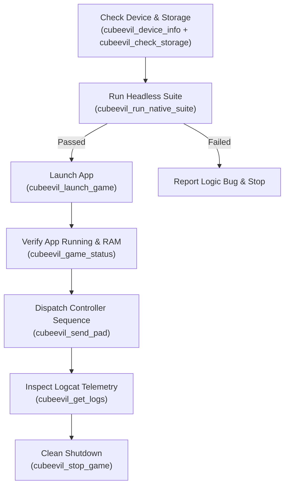

# CubeEvil4 Agent MCP (`cubeevil-agent-mcp`)

High-velocity, deterministic testing and telemetry server for AI agents and developers working on the **CubeEvil4** (Resident Evil 4 GameCube Native Android Decompilation) project.

---

## 1. Problem Statement & Motivation

Traditional LLM agent testing on Android devices relies on a **Vision Screenshot Loop**:
$$\text{Build APK} \longrightarrow \text{Install via ADB} \longrightarrow \text{screencap -p} \longrightarrow \text{adb pull} \longrightarrow \text{LLM Vision API (5-15s)} \longrightarrow \text{Guess UI coordinates}$$

In 3D native game ports (like GameCube RE4 running via Vulkan/GLES3 SurfaceView):
1. **Zero DOM Tree**: `uiautomator dump` returns an empty canvas without accessible UI nodes.
2. **High Latency**: Taking screenshots, transferring images, and running vision inference takes 10–20 seconds per action.
3. **Black-Box Failures**: Vision cannot detect SIGSEGV crashes, memory leaks in MEM1/MEM2, audio buffer starvation, or room ID changes.

**`cubeevil-agent-mcp`** replaces the vision loop with a **direct telemetry & control cockpit** running in sub-100ms per operation.

---

## 2. Server Architecture & Installation

- **Server Location**: `port/tools/cubeevil_mcp.py`
- **Global Config Path**: `C:\Users\Suraj\.gemini\config\scripts\cubeevil_mcp.py`
- **Protocol**: Standard Model Context Protocol (MCP) JSON-RPC over `stdio`.
- **Zero External Dependencies**: Pure Python 3 standard library (`sys`, `os`, `json`, `subprocess`, `re`, `time`, `pathlib`).
- **Registration**: Registered in `C:\Users\Suraj\.gemini\config\mcp_config.json` under `"cubeevil"`. Tool schemas are indexed in `C:\Users\Suraj\.gemini\antigravity\mcp\cubeevil/`.

### Configuration in `mcp_config.json`
```json
"cubeevil": {
  "command": "C:\\Users\\Suraj\\.local\\bin\\python.exe",
  "args": [
    "C:\\Users\\Suraj\\.gemini\\config\\scripts\\cubeevil_mcp.py"
  ],
  "env": {
    "PYTHONUNBUFFERED": "1"
  }
}
```

---

## 3. Tool Reference (10 Core Tools)

### 3.1 Device & Environment Telemetry

#### `cubeevil_device_info`
Queries real-time hardware status of the connected Android device.
- **Parameters**: `serial` (optional string, defaults to first authorized device).
- **Output**:
  ```json
  {
    "serial": "<ADB_DEVICE_SERIAL>",
    "connected": true,
    "manufacturer": "Xiaomi",
    "model": "23049PCD8I",
    "android_version": "15",
    "sdk": "35",
    "supported_abis": ["arm64-v8a", "armeabi-v7a", "armeabi"],
    "resolution": "1080x2400",
    "battery": "71%"
  }
  ```

#### `cubeevil_check_storage`
Verifies that GameCube Discs and memory cards are properly mounted in `/sdcard/Android/data/com.ast.cubeevil4/files/game/`.
- **Parameters**: `serial` (optional string).
- **Output**:
  ```json
  {
    "storage_path": "/sdcard/Android/data/com.ast.cubeevil4/files/game",
    "disc1_imported": true,
    "disc2_imported": true,
    "can_boot_game": true,
    "memcard_files": ["card-a.bin"]
  }
  ```

---

### 3.2 Game Process Lifecycle & State

#### `cubeevil_game_status`
Queries application and background core process status and memory metrics.
- **Parameters**: `serial` (optional string).
- **Output**:
  ```json
  {
    "installed": true,
    "package": "com.ast.cubeevil4",
    "version": "1.1.1-sideload",
    "primary_abi": "arm64-v8a",
    "app_running": true,
    "app_pid": "20820",
    "core_running": false,
    "core_pid": null,
    "memory": {
      "total_pss_kb": 186812,
      "total_pss_mb": 182.43
    }
  }
  ```

#### `cubeevil_launch_game`
Wakes the display, dismisses the keyguard, launches `MainActivity`, and verifies that the process spawned.
- **Parameters**:
  - `start_room` (optional integer): Fast-boot directly into a room (e.g. `100` for village arrival).
  - `debug_hud` (optional boolean): Display internal GameCube debug HUD.
  - `wait_sec` (optional integer, default `5`): Startup wait buffer before reading PID.
  - `serial` (optional string).
- **Output**:
  ```json
  {
    "success": true,
    "app_pid": "20820",
    "core_pid": null,
    "message": "Game launched successfully"
  }
  ```

#### `cubeevil_stop_game`
Terminates `com.ast.cubeevil4` cleanly and eliminates orphaned background `:core` processes.
- **Parameters**: `serial` (optional string).
- **Output**:
  ```json
  {
    "package": "com.ast.cubeevil4",
    "stopped": true,
    "status": "terminated"
  }
  ```

---

### 3.3 Gamepad Input & Action Dispatch

#### `cubeevil_send_pad`
Injects GameCube controller buttons or timed sequences without coordinate ambiguity.
- **Parameters**:
  - `buttons` (array of strings, required): Button names or wait delays (e.g. `["START"]`, `["A", "WAIT:500", "B"]`).
  - `delay_ms` (optional integer, default `200`): Inter-button pause.
  - `serial` (optional string).
- **Supported GameCube Buttons**:
  - `A` (KEYCODE_BUTTON_A / 96)
  - `B` (KEYCODE_BUTTON_B / 97)
  - `X` (KEYCODE_BUTTON_X / 99)
  - `Y` (KEYCODE_BUTTON_Y / 100)
  - `START` (KEYCODE_BUTTON_START / 108)
  - `Z` (KEYCODE_BUTTON_R1 / 103)
  - `L` (KEYCODE_BUTTON_L2 / 104)
  - `R` (KEYCODE_BUTTON_R2 / 105 - Weapon Aim)
  - `UP`, `DOWN`, `LEFT`, `RIGHT` (D-Pad)
  - `BACK` (Android Back / Pause)
  - `WAIT:<ms>` (Inter-key delay, e.g. `WAIT:1000` pauses 1 second)
- **Output**:
  ```json
  {
    "success": true,
    "dispatched_buttons": ["START"],
    "count": 1
  }
  ```

---

### 3.4 Telemetry, Logs & Crash Forensics

#### `cubeevil_get_logs`
Pulls real-time logcat lines filtered specifically for RE4 and engine tags (`RE4Core`, `CubeEvil4`, `MIUIInput`, `re4`, `DEBUG`).
- **Parameters**:
  - `lines` (optional integer, default `100`): Log buffer count.
  - `filter_tag` (optional regex string).
  - `serial` (optional string).
- **Output**:
  ```json
  {
    "total_lines_inspected": 250,
    "matched_count": 3,
    "logs": [
      "11-24 02:25:27.945  2654  3985 I MIUIInput: [KeyEvent] keyCode:108",
      "11-24 02:25:27.946 20820 10585 I re4     : pad: frame 99 buttons 0x1000"
    ]
  }
  ```

#### `cubeevil_get_crash_report`
Instantly inspects logcat crash buffers and `/data/tombstones/` to detect SIGSEGV, SIGABRT, and C++ backtraces.
- **Parameters**: `serial` (optional string).
- **Output**:
  ```json
  {
    "has_crash": false,
    "crash_buffer_lines": [],
    "key_stack_trace": [],
    "tombstones": []
  }
  ```

#### `cubeevil_take_screenshot`
Takes an on-demand screenshot only when visual rendering confirmation is strictly required. Saves directly to `port/build/shots/<filename>`.
- **Parameters**:
  - `filename` (optional string, default `"cubeevil-shot.png"`).
  - `serial` (optional string).
- **Output**:
  ```json
  {
    "captured": true,
    "saved_to": "c:\\Users\\Suraj\\Documents\\Antigravity\\CubeEvil4\\port\\build\\shots\\live_test.png",
    "size_bytes": 71437
  }
  ```

---

### 3.5 Headless Native Suite Verification

#### `cubeevil_run_native_suite`
Executes the headless test binary `/data/local/tmp/re4-port-tests/<abi>/re4_core_tests` directly on the device under the `Global\Retroid_ADB_Exclusive` mutex. Verifies compiler flags, scheduler logic, IR signatures, and audio synthesis in under 3 seconds without rendering UI.
- **Parameters**:
  - `abi` (optional string, `"arm64-v8a"` or `"armeabi-v7a"`).
  - `repeat` (optional integer, default `1`).
  - `serial` (optional string).
- **Output**:
  ```json
  {
    "success": true,
    "exit_code": 0,
    "checks_passed": 20,
    "raw_output": "TOTAL: 20 checks, 0 failures"
  }
  ```

---

## 4. Standard Agent Test Flow (Recipe)

When an AI agent needs to verify a change (e.g. after editing C++ source, patches, or touch styling):



---

## 5. Security & Invariant Guidelines

1. **Named Mutex Compliance**: Any direct ADB operations must respect `Global\Retroid_ADB_Exclusive` via `port/scripts/Retroid-Adb-Exclusive.ps1` to prevent hardware race conditions with parallel runners.
2. **Explicit Target Scoping**: All ADB commands must be scoped with `-s <SERIAL>` and target only package `com.ast.cubeevil4`.
3. **No Unrestricted Screencap Loops**: Never run polling screenshot loops. Rely on `cubeevil_get_logs`, `cubeevil_game_status`, and `cubeevil_get_crash_report` for continuous verification.
